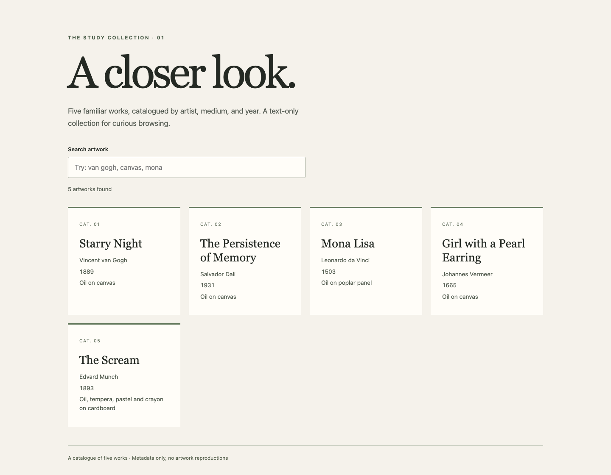

# Curated art catalogue

A compact Next.js application for browsing five artwork records by title, artist, or medium. The collection is deliberately text-only: it contains metadata, not licensed artwork reproductions or a museum integration.



The interface uses a quiet editorial layout, a labelled search field, live result counts, and an explicit empty state. [Mobile view](docs/catalogue-mobile.png) shows the same collection at 390px. Screenshots use only the bundled public artwork metadata.

## Run and check

```sh
npm ci --ignore-scripts
npm run dev
```

Open `http://localhost:3000`. No environment values, database, API keys, or external artwork service are required. For a production build on Node 22, the legacy Next 12 webpack toolchain requires its OpenSSL compatibility flag:

```sh
NODE_OPTIONS=--openssl-legacy-provider npm run build
npm start
npm test
npx tsc --noEmit
```

This review retained Next 12 and React 17; TypeScript was adjusted from 4.5 to 4.9 to parse the already-resolved development type definitions. The lock still reports dependency advisories, including critical ones. A framework/dependency review is needed before internet deployment; the successful local build is not a security certification.

## Data flow

`data/artworks.ts` owns the five typed records. `lib/artworkFilters.ts` normalizes query inputs and filters the collection. `pages/api/artworks.ts` exposes the same logic through a read-only endpoint; `pages/index.tsx` requests it as the search changes and cancels superseded fetches. There is no persistent store or admin UI.

`GET /api/artworks?search=mona&limit=1` returns:

```json
{
  "data": [{"id":3,"title":"Mona Lisa","artist":"Leonardo da Vinci","year":1503,"medium":"Oil on poplar panel"}],
  "total": 1,
  "returned": 1
}
```

Search is a case-insensitive substring match across title, artist, and medium. Repeated parameters use the first value. Limits default to 10, cap at 50, and floor values of at least one; invalid, non-finite, and sub-one limits use the default. `total` counts all matches before limiting; `returned` counts the response records. Other HTTP methods receive 405 with an `Allow` header. There is no pagination cursor, year filter, image API, authentication, or full-text search engine.

## Evidence and next steps

Eight Jest tests pass for filters and API responses, including a sub-one limit regression. Type checking and the production build pass. A real Chrome session against the local API verified all five cards, search, empty state, clearing search, desktop and mobile layouts, and no page errors or horizontal overflow. No external service was contacted for artwork data.

The small in-memory scan is appropriate for five records. A larger collection would need a data source with image rights/provenance, server pagination, and indexed search. The current UI does not debounce every keystroke or validate response JSON at runtime; adding those would be proportionate only as the data source grows.
